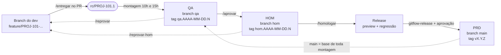

# GitFlow Kit

Implementação portável de um **GitFlow por entregas**: cada branch é publicada em **QA → HOM → PRD** por meio de
**entregas imutáveis** (tags `rc/<ID>.N`), **decisões registradas como tags** (`qa-ok/…`, `hom-ok/…`) e builds
**recriadas a partir da `main`** a cada montagem. Nada vai para um ambiente sem passar pelos **portões de aprovação**
e pela **esteira de publicação**.

O núcleo é shell POSIX (`git`, `jq`, `curl`), sem dependência de plataforma. A conversa com a plataforma Git passa
por **adaptadores**. Hoje o adaptador pronto é o **GitHub** (GitHub Actions + GitHub App).

## O fluxo em um desenho



- A `main` **é** produção. `qa` e `hom` **são** os ambientes. Só o bot (GitHub App) escreve nelas.
- O PR aponta para a `main`, mas **nunca é mergeado pelo botão**: ele é o cartão da branch (review, comandos, histórico).
- Cada build é `main` + as entregas que têm, **naquela entrega exata**, a decisão que o ambiente exige.

Detalhes em [docs/01-fluxo-completo.md](docs/01-fluxo-completo.md).

## Quem faz o quê

| Papel | Team (padrão) | Faz |
|---|---|---|
| Dev | — | branch, PR para a `main`, `/entregar` |
| Tech Lead | `tech-leads` | code review, `/entregar` em nome do autor, `/retirar`, conflitos, `voltar`, `destravar` |
| QA | `qa` | checagem pós-deploy (Environment `checagem-*`), `/aprovar`, `/reprovar`, `/ajuste`, regressão |
| PO / Negócio | `negocio` | `/homologar`, `/alteracao`, `/ajuste`, `/reprovar-hom`, `/retirar` |
| Release Manager | `release-managers` | montagem de release e hotfix, `gitflow-release`, `promover-hotfix`, aprovação de PRD |
| DevOps | — | instalação, GitHub App, secrets, adaptadores de deploy e artefatos |

Passo a passo por papel em [docs/03-guia-por-papel.md](docs/03-guia-por-papel.md).

## Início rápido (GitHub)

```sh
# 1. no clone do kit: copia os chamadores e os modelos para o repositório da aplicação
sh instalar.sh --plataforma github --destino ../minha-app --org minha-org

# 2. crie o GitHub App e grave os secrets GITFLOW_APP_ID e GITFLOW_APP_KEY (docs/04)

# 3. configure Teams, Environments, rulesets, labels, branches qa/hom e o estado inicial de PRD
sh setup/github.sh --repo minha-org/minha-app --app-id 123456

# 4. ajuste scripts/build.sh (gera dist/) e scripts/test.sh (exit 0 = aprovado) na aplicação
```

Instalação completa, do zero, em [docs/04-instalacao-github.md](docs/04-instalacao-github.md).

## Documentação

| Documento | Para quem | Conteúdo |
|---|---|---|
| [01 · Fluxo completo](docs/01-fluxo-completo.md) | todos | branches, tags, estados, montagem, esteira, release, hotfix, exemplo de ponta a ponta |
| [02 · Portões de aprovação](docs/02-portoes-de-aprovacao.md) | todos | cada portão: quem, como, o que o kit confere, onde é imposto |
| [03 · Guia por papel](docs/03-guia-por-papel.md) | Dev, QA, PO, TL, RM, DevOps | rotina diária e "o que fazer quando…" |
| [04 · Instalação no GitHub](docs/04-instalacao-github.md) | DevOps | App, secrets, `instalar.sh`, `setup/github.sh`, contrato da aplicação |
| [05 · Arquitetura e portabilidade](docs/05-arquitetura-e-portabilidade.md) | DevOps, mantenedores | camadas, contratos dos adaptadores, segurança, locks, como portar |
| [06 · Referência](docs/06-referencia.md) | consulta | comandos, workflows, labels, tags, variáveis, códigos de saída |
| [07 · Operação e falhas](docs/07-operacao-e-falhas.md) | TL, RM, DevOps | runbook R0–R11, locks presos, publicação incompleta |

## Arquitetura em 5 linhas

1. `core/*.sh`: as regras do processo (portão de entrada, decisões, montagem, esteira, release, hotfix, volta), sem nenhuma chamada direta à plataforma.
2. `adapters/provider/`: PRs, Teams, deployments e releases (`github.sh`; `fake.sh` para testes).
3. `adapters/artefatos/`, `adapters/deploy/`, `adapters/notificar/`: onde o pacote fica, onde é instalado, para onde vão os avisos.
4. `.github/workflows/gitflow-*.yml`: workflows reutilizáveis que chamam o core, um job por etapa; a aplicação só tem um chamador (`gitflow.yml`).
5. Locks são refs git (`refs/gitflow/lock/*`); decisões e builds são tags anotadas; a verdade de cada ambiente são os deployments da plataforma.

## Situação e limitações

| Item | Situação |
|---|---|
| GitHub (Actions + App) | **pronto** |
| GitLab (provider, CI) | **em desenvolvimento**: `instalar.sh --plataforma gitlab` responde "ainda não disponível" |
| Jenkins | **em desenvolvimento**: `instalar.sh --plataforma jenkins` responde "ainda não disponível" |
| Deploy | `pages` (GitHub Pages) e `pasta`; deploy em IIS ainda não implementado |
| Artefatos | `github-release` (assets da Release `pacotes`) e `pasta` |
| Notificação | `console`, `pr-comment`, `slack`, `teams` (os dois últimos leem o secret opcional `NOTIFICAR_WEBHOOK`, repassado pelos workflows com `secrets: inherit`) |

Outras limitações conhecidas (locks não protegidos por ruleset, horários fixos no chamador, etc.) estão em
[docs/05](docs/05-arquitetura-e-portabilidade.md#limitações-conhecidas).

## Testes do kit

```sh
git submodule update --init
tests/bats/bats-core/bin/bats tests/
```

Requisitos: `git`, `jq`, `shellcheck` (e `actionlint` para os workflows).

## Licença

MIT.
