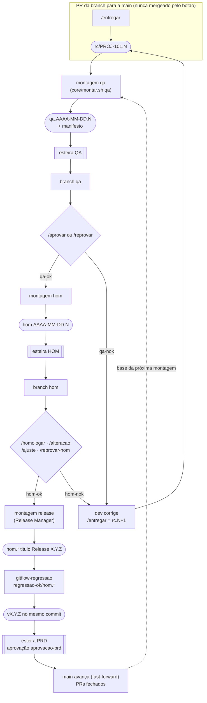
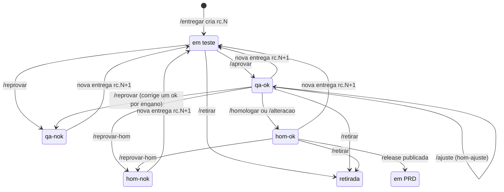
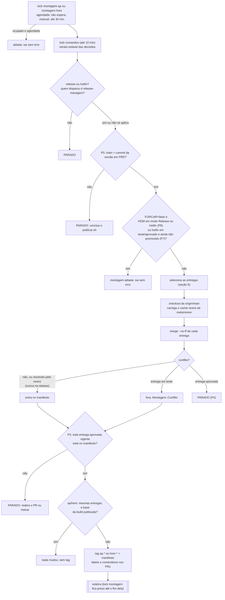
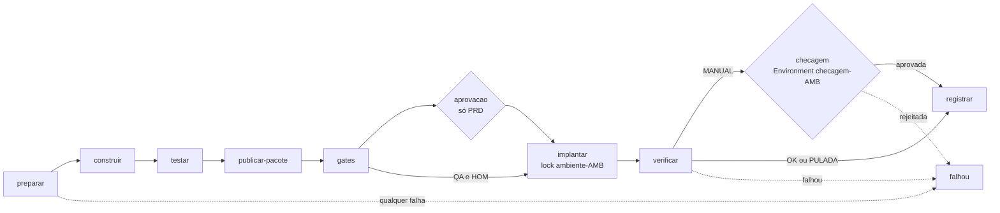
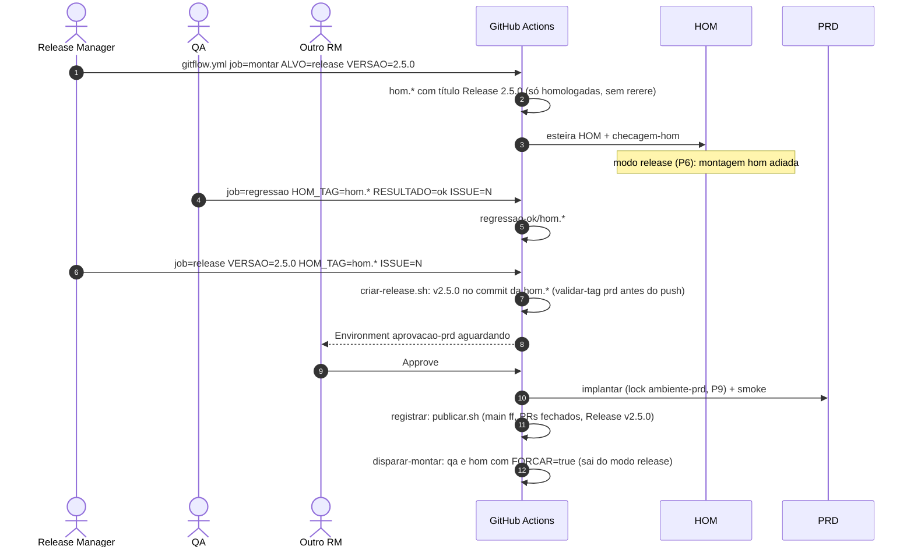
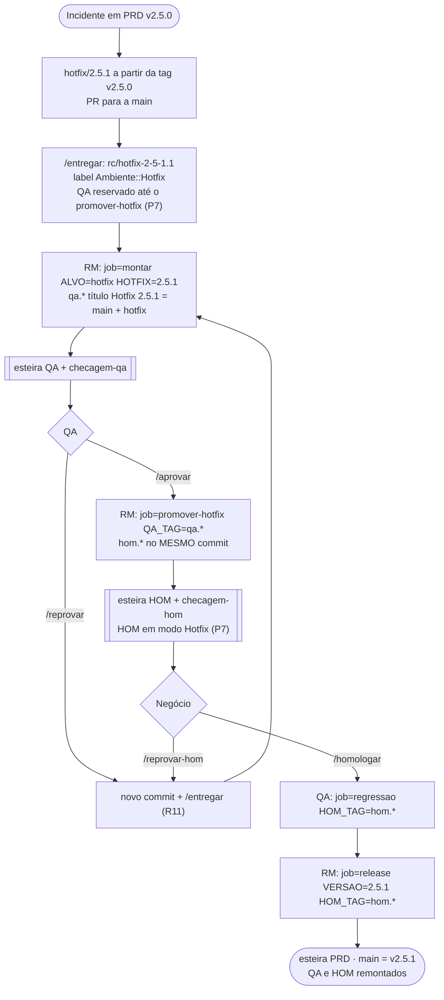

# 01 · Fluxo completo

> Como uma linha de código sai da branch do dev e chega a produção. Os nomes de comandos, tags, labels, jobs e
> scripts deste documento são os do código do kit (`core/`, `.github/workflows/`).

## Sumário

1. [Em uma frase](#1-em-uma-frase)
2. [Ambientes e branches](#2-ambientes-e-branches)
3. [Tags](#3-tags)
4. [Estado de uma entrega](#4-estado-de-uma-entrega)
5. [O que entra em cada build](#5-o-que-entra-em-cada-build)
6. [Montagem](#6-montagem)
7. [Esteira de publicação](#7-esteira-de-publicação)
8. [Release](#8-release)
9. [Hotfix](#9-hotfix)
10. [Exemplo de ponta a ponta: BRANCH 01, 02 e 03](#10-exemplo-de-ponta-a-ponta-branch-01-02-e-03)

---

## 1. Em uma frase

Cada ambiente roda uma build **recriada a partir da `main`** com as entregas que têm, **naquela entrega exata**, a
decisão que o ambiente exige; nenhuma entrega aprovada sai de um ambiente sem motivo registrado.



---

## 2. Ambientes e branches

| Ambiente | Branch | Tag da build | Quem move a branch | Verdade do ambiente |
|---|---|---|---|---|
| QA | `qa` | `qa.AAAA-MM-DD.N` | só a esteira (job `implantar`) ou `voltar.sh` | último deployment do environment `qa` |
| HOM | `hom` | `hom.AAAA-MM-DD.N` | só a esteira ou `voltar.sh` | último deployment do environment `hom` |
| PRD | `main` | `vX.Y.Z` | só `core/publicar.sh`, por fast-forward, depois do PRD verificado | último deployment `success` do environment `production` |

| Branch | Nasce de | Quem escreve | Observação |
|---|---|---|---|
| `main`, `qa`, `hom` | — | só o GitHub App (ruleset `gitflow-ambientes`) | ninguém faz commit, merge ou PR nelas |
| `feature/<ID>-<descricao>` | `main` | dev | `<ID>` casa com `ID_REGEX` (padrão `[A-Z]+-[0-9]+`); a descrição só aceita `[a-z0-9-]` |
| `bugfix/<ID>-<descricao>` | `main` | dev | bug não urgente; mesmo fluxo da feature |
| `hotfix/X.Y.Z` | a tag em PRD | dev autorizado | exatamente três números; vira o ID `hotfix-X-Y-Z` |
| `meta/rerere` | — | Tech Lead (`resolver-conflito.sh --publicar`) | cache de resoluções de conflito usado pela montagem |
| `gh-pages` | — | adaptador `pages` | só no deploy de demonstração (GitHub Pages: `qa/`, `hom/`, raiz = PRD) |

> [!IMPORTANT]
> A branch de um ambiente responde "o que está publicado agora". As tags respondem "o que já passou por lá".
> `qa` e `hom` são movidas com force push pelo App **depois** do deploy; a `main` nunca recebe force push.

---

## 3. Tags

Todas são **anotadas** e criadas só pelo App (ruleset `gitflow-tags`; `v*` também pela Team `release-managers`,
ruleset `gitflow-versoes`). Nenhuma é movida ou apagada.

| Tag | Exemplo | Aponta para | Criada por | Significa |
|---|---|---|---|---|
| `rc/<ID>.N` | `rc/PROJ-101.2` | último commit do PR | `/entregar` (`core/criar-rc.sh`) | a entrega: o código exato a testar |
| `qa.AAAA-MM-DD.N` | `qa.2026-10-14.2` | commit montado | `core/montar.sh qa` ou `hotfix` | build do QA; a mensagem é o manifesto |
| `hom.AAAA-MM-DD.N` | `hom.2026-10-15.1` | commit montado | `core/montar.sh hom` ou `release`; `core/promover-hotfix.sh` | build da HOM (preview); título `Build hom`, `Release X.Y.Z` ou `Hotfix X.Y.Z` |
| `vX.Y.Z` | `v2.5.0` | o **mesmo commit** de uma `hom.*` | `core/criar-release.sh` | versão para PRD |
| `qa-ok/<ID>.N` · `qa-nok/<ID>.N` | `qa-ok/PROJ-101.1` | commit da entrega | `/aprovar` · `/reprovar` | decisão do QA sobre **esta** entrega |
| `hom-ok/<ID>.N` · `hom-nok/<ID>.N` | `hom-ok/PROJ-101.1` | commit da entrega | `/homologar` ou `/alteracao` · `/reprovar-hom` | decisão do negócio |
| `hom-ajuste/<ID>.N` | `hom-ajuste/PROJ-101.1` | commit da entrega | `/ajuste` | a próxima entrega desse PR tem reteste expresso |
| `retirada/<ID>.N` | `retirada/PROJ-104.2` | commit da entrega | `/retirar` | a entrega sai de todos os ambientes sem ir para PRD |
| `regressao-ok/<hom.*>` | `regressao-ok/hom.2026-10-15.1` | commit da preview | `gitflow-regressao` (`core/regressao.sh`) | a preview pode virar versão |

A mensagem de cada tag de decisão guarda o comando, quem decidiu, a build em que a entrega estava e o motivo:

```
/reprovar por @qa1 na build qa.2026-10-14.1

erro no banco de horas ao fechar o mês
```

O **manifesto** (mensagem da tag de build) tem este formato (`!N` é o número do PR):

```
Build qa

base main 3f2a9c1 (v2.4.0)
rerere 7b1d0e2
rc/PROJ-101.1 !11 9f3c2a1 homologada
rc/PROJ-102.1 !12 a7d41e0 aprovada QA
rc/PROJ-103.2 !13 c81e7f2 em teste (reteste expresso)
fora: rc/PROJ-104.1 !21 conflito
saiu: rc/PROJ-103.1 substituída por rc/PROJ-103.2
fila: rc/PROJ-105.1 !22 posição 1
```

---

## 4. Estado de uma entrega

O estado é calculado pela **última entrega** do PR e pelas tags de decisão dela (`estado()` em `core/lib.sh`).
Quando há mais de uma, vale a primeira desta ordem: `retirada` > `hom-nok` > `qa-nok` > `hom-ok` > `qa-ok` > em teste.
O label `Ambiente::*` é só espelho: o kit o reescreve a cada `/entregar`, decisão e montagem.

| Última entrega tem | Estado | Label |
|---|---|---|
| nenhuma decisão | em teste | `Ambiente::QA` (`Ambiente::Hotfix` se for hotfix) |
| `qa-nok` | reprovada no QA | `Ambiente::QA reprovado` |
| `qa-ok` | aprovada pelo QA | `Ambiente::HOM` |
| `qa-ok` + `hom-nok` | reprovada na HOM | `Ambiente::HOM reprovado` |
| `qa-ok` + `hom-ok` | homologada | `Ambiente::Homologado` |
| `retirada` | retirada | `Ambiente::Retirada` |
| contida na `vX.Y.Z` em PRD | em produção (PR fechado) | `Ambiente::PRD` |



> [!IMPORTANT]
> **Toda nova entrega começa sem decisão.** A aprovação vale para o código testado, não para a branch.
> Entregar de novo algo aprovado tira a branch da HOM e da próxima release; por isso o kit pede `/entregar confirmo`.

---

## 5. O que entra em cada build

| Build (ALVO) | Entra a última entrega de cada PR aberto para a `main` que está… | Ordem dos merges |
|---|---|---|
| `qa` | homologada, aprovada pelo QA ou em teste (fila) | homologadas (por data do `hom-ok`) → aprovadas (por data do `qa-ok`) → em teste (fila) |
| `hom` | homologada ou aprovada pelo QA | homologadas → aprovadas |
| `release` | homologada | homologadas, por data do `hom-ok` |
| `hotfix` | a entrega do PR `hotfix/<HOTFIX>` | só ela |

Ficam fora: `qa-nok`, `hom-nok`, `retirada`, PRs sem entrega, PRs fechados.

**Fila do QA** (só entregas em teste, `LIMITE_QA` padrão 6 por build; aprovadas e homologadas não contam):

| Peso | Quem | Origem |
|---|---|---|
| 0 | já está em teste na build publicada | mantém o lugar |
| 1 | reteste expresso: a entrega anterior do PR teve `qa-nok`, `hom-nok` ou `hom-ajuste` | tags de decisão |
| 2 | label `Suspeita de checagem` | QA, à mão; volta **sozinha** (nenhuma entrega nova entra naquela montagem) |
| 3, 4, 5 | labels `Prioridade::1`, `::2`, `::3` | PO |
| 6 | demais | por antiguidade da tag `rc/` |

- Na montagem **agendada**, entregas com peso > 1 criadas nos últimos 30 minutos esperam a próxima janela.
- Com `EXPRESSO=true`, só entram (além das que já estão em teste) entregas de peso 1.
- Quem fica de fora recebe o label `Montagem::Fila` e um comentário com a posição.

---

## 6. Montagem

`core/fluxo-montar.sh ALVO` (workflow `gitflow-montar`) pega os locks e chama `core/montar.sh ALVO`.



| Quando | ALVO | Gatilho no chamador `gitflow.yml` |
|---|---|---|
| 10h e 15h, seg–sex (`0 13,18 * * 1-5` UTC) | `qa` | `schedule` |
| 17h, seg–sex (`0 20 * * 1-5` UTC) | `hom` | `schedule` |
| a qualquer momento | `qa` (opcional `EXPRESSO`), `hom` | `workflow_dispatch` com `job=montar` |
| dia da release | `release` com `VERSAO=X.Y.Z` | `workflow_dispatch` (só `release-managers`) |
| urgência | `hotfix` com `HOTFIX=X.Y.Z` | `workflow_dispatch` (só `release-managers`) |
| depois de cada publicação em PRD | `qa` e `hom` com `FORCAR=true` | automático (`ci/github-actions/disparar-montar.sh`) |

> [!NOTE]
> Os horários estão no cron do chamador `gitflow.yml` da aplicação (UTC). Para mudar, edite o `schedule` ali e a
> expressão que decide `hom` (`github.event.schedule == '0 20 * * 1-5'`).

---

## 7. Esteira de publicação

Toda publicação (QA, HOM, PRD) passa pelo workflow reutilizável `gitflow-esteira`, um job por etapa
(`core/esteira.sh ETAPA`). O estado passa entre jobs pelo arquivo `$GITFLOW_SAIDA/esteira.env` (artefatos
`gitflow-estado-*`).



| Job | Token do App | O que faz | Diferença por ambiente |
|---|---|---|---|
| `preparar` | sim | `validar-tag.sh TAG AMB`; `CONSTRUIR=sim` se ainda não existe pacote para o commit | PRD: o pacote precisa existir (PRD nunca compila); `PULAR_CHECAGEM` só vale para a build já publicada (R7) |
| `construir` | não | `scripts/build.sh` da aplicação; zipa `dist/` em `app-<sha>.zip` + `.sha256` | pulado se o pacote já existe |
| `testar` | não | `scripts/test.sh`; grava `TESTADO=sim` | idem |
| `publicar-pacote` | sim | envia o pacote ao repositório de artefatos (P12: só se `TESTADO=sim`) | idem; o pacote nunca é sobrescrito |
| `gates` | não | `scripts/gates.sh AMB SHA`, se existir | mesmas regras em todos |
| `aprovacao` | — | espera a aprovação do Environment `aprovacao-prd` (Team `release-managers`) | **só PRD** |
| `implantar` | sim | pega `ambiente-AMB` (até 30 min), busca de novo, **revalida a tag dentro do lock (P9)**, cria o deployment, baixa o pacote (SHA-256 conferido), instala, move `qa`/`hom` | PRD não move a `main` aqui |
| `verificar` | não | `scripts/checar.sh AMB` (QA/HOM) ou `scripts/smoke.sh prd` / `deploy_saude prd` (PRD) | sem `checar.sh` em QA/HOM: `VERIFICAR=MANUAL` |
| `checagem` | — | espera a aprovação do Environment `checagem-qa` ou `checagem-hom` (Team `qa`), **sem prazo** (P15) | só quando `VERIFICAR=MANUAL` e sem `PULAR_CHECAGEM` |
| `registrar` | sim | deployment `success`; em PRD roda `core/publicar.sh` (até 3 tentativas) e dispara a remontagem de QA e HOM; solta `ambiente-AMB` e `montagem-AMB` | PRD: `main` avança, PRs fechados, Release do GitHub criada |
| `falhou` | sim | decide se volta o ambiente (`ci/github-actions/falhou.sh`) | ver [07](07-operacao-e-falhas.md) |

**O que vai em cada build:** o pacote é do **commit**. QA compila e testa o commit montado; a HOM reaproveita o
pacote se o commit já foi compilado; PRD instala **o mesmo arquivo** da preview (`vX.Y.Z` está no mesmo commit da
`hom.*`), conferindo o SHA-256.

**Locks da esteira** (`refs/gitflow/lock/*`, `core/lock.sh`):

| Lock | Pego por | Solto por |
|---|---|---|
| `comandos` | job de comandos (até 15 min de espera); montagem (até 10 min) | o mesmo job |
| `montagem-qa` / `montagem-hom` | `fluxo-montar.sh` | fim da esteira (`registrar` ou `falhou`); na hora, se a montagem não criou tag |
| `ambiente-qa` / `ambiente-hom` / `ambiente-prd` | job `implantar`; `gitflow-voltar` | `registrar`; `falhou` depois da volta; `gitflow-voltar` com sucesso |

---

## 8. Release



| Regra | Onde |
|---|---|
| A release leva só as homologadas **no momento da montagem**; conflito na release sempre para (rerere não se aplica) | `core/montar.sh` |
| `regressao-ok` obrigatório, mesmo se a preview do dia já tem só homologadas | `core/criar-release.sh`, `core/validar-tag.sh` |
| `HOM_TAG` precisa ser a build **publicada e verificada** agora na HOM, com título `Release X.Y.Z` (ou `Hotfix X.Y.Z`) igual à `VERSAO` | `core/criar-release.sh` |
| Dentro do lock de PRD: contém a `main` e a versão em PRD; cada entrega do manifesto é a última do PR e está `hom-ok` (P9) | `core/validar-tag.sh` no job `implantar` |
| `main` só avança depois do PRD verificado, por fast-forward | `core/publicar.sh` |
| Cancelar a release: `job=montar ALVO=hom FORCAR=true` (sai do modo release; a `v*` criada fica sem uso) | `core/montar.sh` |

---

## 9. Hotfix



| Regra | Onde |
|---|---|
| Branch só `hotfix/X.Y.Z`; um hotfix ativo por vez (P14) | `core/criar-rc.sh` |
| Enquanto a entrega do hotfix está em teste, a montagem `qa` normal é adiada | `hotfix_aguardando_qa` em `core/lib.sh` |
| Com a HOM publicando uma `hom.*` "Hotfix", a montagem `hom` normal é adiada | `core/montar.sh` |
| `montar hotfix` e `promover-hotfix` só para `release-managers` | `core/montar.sh`, `core/promover-hotfix.sh` |
| A promoção exige a `qa.*` "Hotfix X.Y.Z" publicada e verificada no QA e a entrega com `qa-ok` | `core/promover-hotfix.sh` |
| Release em andamento sem o hotfix: a esteira de PRD recusa (P9: não contém a versão em PRD) | `core/validar-tag.sh` |

> [!WARNING]
> Depois do `/aprovar` do hotfix, a montagem `qa` deixa de ser adiada. Se uma montagem `qa` (agendada) rodar antes do
> `promover-hotfix`, a `qa.*` do hotfix deixa de ser a publicada e a promoção é recusada. Promova logo depois do
> `/aprovar`, ou monte o hotfix de novo.

---

## 10. Exemplo de ponta a ponta: BRANCH 01, 02 e 03

Produção está em `v2.4.0`. Três tarefas, três PRs para a `main`:

| | Tarefa | Branch | PR |
|---|---|---|---|
| BRANCH 01 | PROJ-101 | `feature/PROJ-101-cadastro-ponto` | #11 |
| BRANCH 02 | PROJ-102 | `feature/PROJ-102-relatorio-horas` | #12 |
| BRANCH 03 | PROJ-103 | `feature/PROJ-103-banco-horas` | #13 |

Este roteiro é o mesmo de `tests/historia.bats` (que o executa com os scripts reais).

| Dia | Quem | Ação (exata) | Resultado | QA | HOM | PRD |
|---|---|---|---|---|---|---|
| 1 seg 12/10 | dev01, dev02 | comentam `/entregar` em #11 e #12 | `rc/PROJ-101.1`, `rc/PROJ-102.1`; label `Ambiente::QA` | | | v2.4.0 |
| 1 10h | agenda | montagem `qa` | `qa.2026-10-12.1` = main + 01 + 02 → esteira → `checagem-qa` aprovada pelo QA | 01 + 02 | | v2.4.0 |
| 1 | QA | `/aprovar` em #11 | `qa-ok/PROJ-101.1`; label `Ambiente::HOM` | 01 + 02 | | v2.4.0 |
| 1 15h | agenda | montagem `qa` | mesmas entregas: "nada mudou", sem tag | 01 + 02 | | v2.4.0 |
| 1 17h | agenda | montagem `hom` | `hom.2026-10-12.1` = main + 01 → esteira → aguarda `checagem-hom` | 01 + 02 | 01 | v2.4.0 |
| 2 8h30 | QA | aprova `checagem-hom` no run da esteira | HOM liberada ao negócio | 01 + 02 | 01 | v2.4.0 |
| 2 | agenda | montagens `qa` e `hom` | "nada mudou" nas duas | 01 + 02 | 01 | v2.4.0 |
| 3 qua 14/10 | dev03 | `/entregar` em #13 | `rc/PROJ-103.1` | | | |
| 3 10h | agenda | montagem `qa` | `qa.2026-10-14.1` = main + 01 + 02 + 03 | 01 + 02 + 03 | 01 | v2.4.0 |
| 3 | QA | `/reprovar erro no banco de horas` em #13; `/aprovar` em #12 | `qa-nok/PROJ-103.1`, `qa-ok/PROJ-102.1` | | | |
| 3 | PO | `/homologar` em #11 | `hom-ok/PROJ-101.1`; label `Ambiente::Homologado` | | | |
| 3 15h | agenda | montagem `qa` | `qa.2026-10-14.2` = main + 01 + 02; manifesto: `saiu: rc/PROJ-103.1 (qa-nok)` | 01 + 02 | 01 | v2.4.0 |
| 3 17h | agenda | montagem `hom` | `hom.2026-10-14.1` = main + 01 + 02 | 01 + 02 | 01 + 02 | v2.4.0 |
| 4 qui 15/10 9h | RM | `job=montar ALVO=release VERSAO=2.5.0` | `hom.2026-10-15.1` "Release 2.5.0" = main + 01 (a 02 não está homologada) | 01 + 02 | 01 (release) | v2.4.0 |
| 4 9h–12h | QA | regressão; `job=regressao HOM_TAG=hom.2026-10-15.1 RESULTADO=ok ISSUE=42` | `regressao-ok/hom.2026-10-15.1` | | | |
| 4 14h | RM | `job=release VERSAO=2.5.0 HOM_TAG=hom.2026-10-15.1 ISSUE=42` | `v2.5.0` no commit da preview → esteira PRD aguarda `aprovacao-prd` | | | |
| 4 14h | outro RM | aprova `aprovacao-prd` | deploy, smoke, `publicar.sh`: `main` = `v2.5.0`; #11 fechado (label `Ambiente::PRD`, branch apagada); Release `v2.5.0` | | | **v2.5.0** |
| 4 | automático | remontagem `qa` e `hom` com `FORCAR=true` | QA = main + 02; HOM = main + 02 (sai do modo release) | 02 | 02 | v2.5.0 |
| 4 | dev03 | `git fetch && git rebase origin/main`, corrige, push, `/entregar` em #13 | `rc/PROJ-103.2` com label `Reteste expresso` (peso 1) | | | |
| 4 | QA ou agenda | montagem `qa` (pode ser `EXPRESSO=true`) | QA = main + 02 + 03.2 (manifesto: `em teste (reteste expresso)`) | 02 + 03.2 | 02 | v2.5.0 |

O que observar:

- A 02 em teste **não travou** a 01: cada entrega é decidida separadamente.
- A 03 reprovada **só deixou de entrar** na próxima montagem; não houve revert.
- Só a 01 foi para PRD: a release é montada só com homologadas, e `v2.5.0` é o mesmo commit e o mesmo pacote da
  preview que passou na regressão.
- A 03 precisou de rebase na nova `main`: o `/entregar` exige que a branch contenha a `main` e a versão em PRD.

---

<p align="center"><a href="../README.md">Índice</a> · <a href="02-portoes-de-aprovacao.md">02 · Portões de aprovação ➜</a></p>
