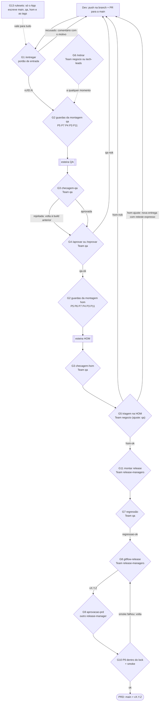
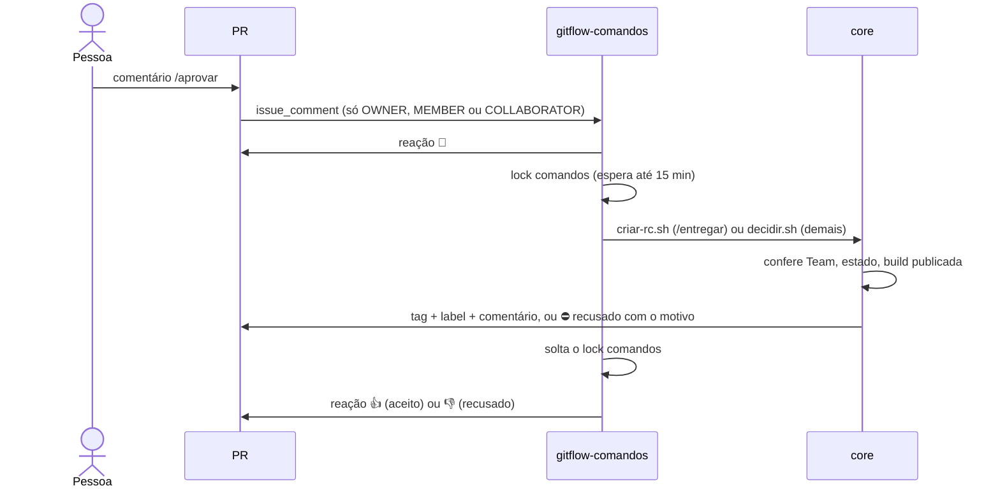
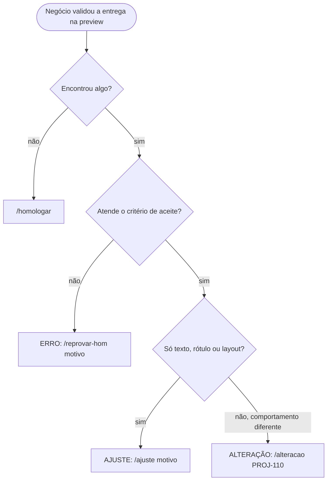

# 02 · Portões de aprovação

> Cada ponto do fluxo em que alguém (ou o kit) precisa dizer "pode seguir". Para cada portão: quando acontece,
> quem pode, como agir, o que o kit confere antes de aceitar, o que acontece em cada resposta e onde a regra é imposta.
> As proteções P1–P15 e os retornos R0–R11 têm os mesmos números do processo.

## Sumário

- [Visão geral: todos os portões no fluxo](#visão-geral-todos-os-portões-no-fluxo)
- [Tabela-resumo](#tabela-resumo)
- [Como os comandos de PR são processados](#como-os-comandos-de-pr-são-processados)
- [G1 · Portão de entrada: `/entregar`](#g1--portão-de-entrada-entregar)
- [G2 · Guardas da montagem: P3, P4, P5, P6, P7, P11](#g2--guardas-da-montagem-p3-p4-p5-p6-p7-p11)
- [G3 · Checagem pós-deploy (QA e HOM)](#g3--checagem-pós-deploy-qa-e-hom)
- [G4 · Decisão do QA: `/aprovar` e `/reprovar`](#g4--decisão-do-qa-aprovar-e-reprovar)
- [G5 · Decisão da HOM: `/homologar`, `/alteracao`, `/ajuste`, `/reprovar-hom`](#g5--decisão-da-hom-homologar-alteracao-ajuste-reprovar-hom)
- [G6 · Retirada: `/retirar`](#g6--retirada-retirar)
- [G7 · Regressão da preview: `gitflow-regressao`](#g7--regressão-da-preview-gitflow-regressao)
- [G8 · Criação da versão: `gitflow-release`](#g8--criação-da-versão-gitflow-release)
- [G9 · Aprovação de PRD: Environment `aprovacao-prd`](#g9--aprovação-de-prd-environment-aprovacao-prd)
- [G10 · Revalidação de PRD dentro do lock (P9) e smoke](#g10--revalidação-de-prd-dentro-do-lock-p9-e-smoke)
- [G11 · Montagem de release e hotfix, promoção do hotfix (Release Manager)](#g11--montagem-de-release-e-hotfix-promoção-do-hotfix-release-manager)
- [G12 · Operações de recuperação: `voltar` e `destravar`](#g12--operações-de-recuperação-voltar-e-destravar)
- [G13 · Proteções da plataforma (rulesets)](#g13--proteções-da-plataforma-rulesets)
- [O que o processo descreve e o kit ainda não impõe](#o-que-o-processo-descreve-e-o-kit-ainda-não-impõe)

---

## Visão geral: todos os portões no fluxo

## Tabela-resumo

| # | Portão | Quem (Team padrão) | Como | Imposto por |
|---|---|---|---|---|
| G1 | Entrada da entrega | autor do PR ou `tech-leads` | comentário `/entregar` | `core/criar-rc.sh` |
| G2 | Guardas da montagem | automático | — | `core/montar.sh`, `core/fluxo-montar.sh` |
| G3 | Checagem pós-deploy | `qa` | botão **Approve/Reject** do Environment `checagem-qa` / `checagem-hom` (ou `scripts/checar.sh`) | job `checagem` + `ci/github-actions/falhou.sh` |
| G4 | Decisão do QA | `qa` | `/aprovar`, `/reprovar <motivo>` | `core/decidir.sh` |
| G5 | Decisão da HOM | `negocio` (`/ajuste`: `negocio` ou `qa`) | `/homologar`, `/alteracao <tarefa>`, `/ajuste <motivo>`, `/reprovar-hom <motivo>` | `core/decidir.sh` |
| G6 | Retirada | `negocio` ou `tech-leads` | `/retirar <motivo>` | `core/decidir.sh` |
| G7 | Regressão | `qa` | `workflow_dispatch` `job=regressao` | `core/regressao.sh` |
| G8 | Criação da versão | `release-managers` | `workflow_dispatch` `job=release` | `core/criar-release.sh` + `core/validar-tag.sh` |
| G9 | Aprovação de PRD | `release-managers`, outra pessoa | botão **Approve/Reject** do Environment `aprovacao-prd` | job `aprovacao` (Environment com `prevent_self_review`) |
| G10 | Revalidação de PRD e smoke | automático | — | `core/validar-tag.sh` no job `implantar`; `scripts/smoke.sh` ou `deploy_saude` |
| G11 | Montar release/hotfix, promover hotfix | `release-managers` | `workflow_dispatch` `job=montar` / `job=promover-hotfix` | `core/montar.sh`, `core/promover-hotfix.sh` |
| G12 | Voltar ambiente, destravar lock | `tech-leads` ou `release-managers` | `workflow_dispatch` `job=voltar` / `job=destravar` | `ci/github-actions/exige-membro.sh` |
| G13 | Escrita em branches e tags protegidas | só o GitHub App (e `release-managers` em `v*`) | — | rulesets `gitflow-ambientes`, `gitflow-tags`, `gitflow-versoes` |

Os nomes das Teams vêm do `.gitflow.env` (`GRUPO_QA`, `GRUPO_NEGOCIO`, `GRUPO_TL`, `GRUPO_RM`), inclusive em G12
(`voltar`/`destravar` conferem `GRUPO_TL` e `GRUPO_RM`).

---

## Como os comandos de PR são processados

Todo comando de G1, G4, G5 e G6 é um **comentário no PR** cuja primeira palavra é o comando.

- O workflow roda a versão da `main` (evento `issue_comment`); o código do PR nunca roda com o token do App.
- O texto do comentário chega aos scripts só por variável de ambiente (`NOTA`) e nunca é avaliado pelo shell.
- Comandos desconhecidos são ignorados sem reação. Pessoas de fora do repositório (sem associação) são ignoradas.
- O lock `comandos` serializa comandos e montagens: a montagem vê um retrato estável das decisões.

---

## G1 · Portão de entrada: `/entregar`

| | |
|---|---|
| **Quando** | O dev terminou, o PR está revisado e o CI está verde. Também para cada correção (R3, R4, R5, R5a) |
| **Quem** | O autor do PR, ou um membro de `GRUPO_TL` (`tech-leads`) em nome dele |
| **Como** | Comentar `/entregar` no PR. Para reentregar algo aprovado: `/entregar confirmo` |
| **Resultado** | Tag `rc/<ID>.N` no último commit do PR; label `Ambiente::QA` (ou `Ambiente::Hotfix`); comentário "📦 Entrega rc/… criada" |

**O que o kit confere, na ordem** (`core/criar-rc.sh`; qualquer falha comenta "⛔ Entrega recusada: …" e nada é criado):

| # | Verificação | Proteção | Mensagem de recusa (resumo) |
|---|---|---|---|
| 1 | Branch `hotfix/X.Y.Z` (três números) ou `feature\|bugfix/<ID>-<descricao>` com `<ID>` casando `ID_REGEX` | — | "nome de branch fora do padrão" / "use hotfix/X.Y.Z" |
| 2 | O PR aponta para a `main` | — | "precisa apontar para a main (sub-branch de épico entrega pelo PR do épico)" |
| 3 | O PR não é rascunho | — | "está em rascunho (draft)" |
| 4 | Quem comentou é o autor ou é de `tech-leads` | — | "só o autor do PR ou um Tech Lead pode entregar" |
| 5 | Nenhum outro PR aberto usa o mesmo ID; não há outro hotfix ativo | P14 | "!N usa o mesmo ID" / "hotfix !N ainda ativo" |
| 6 | A branch contém a `main` atual | — | "a branch não contém a main. Rode git rebase origin/main" |
| 7 | A branch contém a versão em PRD (último deployment `success` de `production`) | — | "a branch não contém a versão em PRD" |
| 8 | A branch não contém nenhuma `rc/*` de outro PR que ainda não está na `main` | **P13** | "a branch contém a entrega rc/…, de outro PR, que ainda não está em PRD" |
| 9 | O CI do último commit está verde (check-runs e statuses, exceto os de nome `gitflow*`); sem nenhum check conta como não verde | R1 | "o pipeline do último commit não está verde" |
| 10 | Há aprovação de code review de **outra pessoa**, feita sobre o **último commit** (vale a última revisão de cada pessoa) | R0 | "falta aprovação de code review" |
| 11 | As seções `## Critério de aceite` e `## Como testar` do template têm texto (linhas que começam com `(` não contam) | — | "a seção … está vazia" |
| 12 | Nenhum item `- [ ]` sem marcar no corpo do PR | — | "há itens do autoteste sem marcar" |
| 13 | O commit não é o mesmo da entrega anterior | — | "este commit já é a entrega rc/…" |
| 14 | Se a entrega anterior está `qa-ok` ou `hom-ok` (sem `hom-ajuste`), o comentário contém `confirmo` | — | "…Para seguir, comente: /entregar confirmo" |

**Depois de aceitar:** remove `Montagem::Conflito`, `Montagem::Fila`, `Suspeita de checagem` e `Reteste expresso`;
se a entrega anterior teve `qa-nok`, `hom-nok` ou `hom-ajuste`, coloca `Reteste expresso` (peso 1 na fila).

**`MODO_DEMO=sim`** (só demonstração com uma pessoa): a falta de review de outra pessoa (item 10) é dispensada, com
aviso "⚠️ MODO_DEMO" no PR. É uma das duas únicas regras que o modo demo relaxa (a outra está em G9).

---

## G2 · Guardas da montagem: P3, P4, P5, P6, P7, P11

| | |
|---|---|
| **Quando** | Em toda montagem (`gitflow-montar`): agendada, manual, release, hotfix, remontagem depois do PRD |
| **Quem** | Automático. Disparar à mão: quem pode rodar workflows no repositório; `release`/`hotfix` só `release-managers` (G11) |
| **Como** | — (o resultado aparece no log do run, no manifesto e nos PRs) |

| Guarda | O que confere | Se falhar | Onde |
|---|---|---|---|
| **P11** montagem e publicação são uma unidade | lock `montagem-qa`/`montagem-hom` preso da montagem até o fim da esteira | agendada: "adiada" (sai sem erro); manual: espera até 30 min e então para | `core/fluxo-montar.sh` |
| **P5** `main` = PRD | o commit do último deployment `success` de PRD é o commit da `origin/main` | **PARADO**: "a main não é igual a PRD. Conclua o publicar.sh antes de montar" | `core/montar.sh` |
| **P6** modo release | se a build publicada na HOM tem título `Release …` ou `Hotfix …`, a montagem `hom` não roda | "montagem adiada" (sai sem erro) | `core/montar.sh` |
| **P7** modo hotfix | se há PR `hotfix/*` cuja última entrega está em teste **ou aprovada no QA e ainda não promovida** (nenhuma `hom.*` "Hotfix X.Y.Z" com a entrega no manifesto), a montagem `qa` não roda: o QA fica reservado do `/entregar` até o `promover-hotfix` | "hotfix em teste: QA reservado" (sai sem erro) | `core/montar.sh`, `hotfix_aguardando_qa` |
| P6/P7 forçados | `FORCAR=true` desliga só essas duas guardas (cancelar release; remontagem depois do PRD) | — | `core/montar.sh` |
| **P4** conflito de aprovada | entrega homologada ou aprovada que conflita (e o rerere não resolve; na release nunca resolve) | **PARADO**: "conflito em entrega aprovada" | `core/montar.sh` |
| conflito de entrega em teste (R2a) | — | fica fora: label `Montagem::Conflito` e comentário "Atualize com a main e entregue de novo" | `core/montar.sh` |
| **P3** guarda do manifesto | toda entrega aprovada vigente (`qa-ok` para `qa`/`hom`, `hom-ok` para `release`) está na build; pega PR fechado, label mexido, etc. | **PARADO**: "entregas aprovadas fora da build sem motivo. Reabra o PR ou use /retirar" | `core/montar.sh`, `aprovadas_vigentes` |
| nada mudou | em `qa`/`hom`, mesma base, mesmo rerere e mesmas entregas da build publicada | sem tag, sem esteira ("nada mudou desde …") | `core/montar.sh` |

Quando a montagem para (PARADO), o kit chama `notificar alerta`, o run falha e os locks `comandos` e `montagem-*`
são soltos. O que fazer em cada caso: [07 · Operação e falhas](07-operacao-e-falhas.md).

---

## G3 · Checagem pós-deploy (QA e HOM)

| | |
|---|---|
| **Quando** | Depois do deploy em QA ou HOM, quando a aplicação **não** tem `scripts/checar.sh` (`VERIFICAR=MANUAL`) |
| **Quem** | Team `qa` (revisores dos Environments `checagem-qa` e `checagem-hom`, criados por `setup/github.sh`) |
| **Como** | Abrir o run da esteira em **Actions**, botão **Review deployments**, marcar `checagem-qa` (ou `checagem-hom`) e **Approve** ou **Reject** |
| **Automática** | Com `scripts/checar.sh AMB` na aplicação, o job `verificar` decide sozinho e o job `checagem` não roda |

**Enquanto ninguém responde** (P15): o run fica esperando, o ambiente fica "aguardando checagem", o deployment fica
sem status final, os locks `ambiente-AMB` e `montagem-AMB` continuam presos e as montagens agendadas daquele ambiente
saem como "adiada". Nenhuma decisão `/aprovar` ou `/homologar` é aceita para essa build (G4/G5 exigem deployment
`success`).

| Resposta | O que acontece | Onde |
|---|---|---|
| **Approve** | job `registrar`: deployment `success`, `notificar publicado`, solta os locks. A build passa a aceitar decisões | `core/esteira.sh registrar` |
| **Reject** | job `falhou`: confere em `GET /actions/runs/{id}/approvals` que houve **rejeição explícita** de `checagem-AMB`; marca o deployment `failed`, roda `core/voltar.sh` (reinstala a última build `success` e move a branch), solta os locks | `ci/github-actions/falhou.sh`, `core/voltar.sh` |
| **Expirou** (limite do GitHub) ou erro | **não volta** (P15): alerta "não foi rejeitada… segue travado"; locks mantidos | `ci/github-actions/falhou.sh` |
| `scripts/checar.sh` falhou | job `falhou` volta o ambiente (falha automática conta como rejeição) | `core/esteira.sh falhou` |
| `PULAR_CHECAGEM=true` | só para republicar a build **já publicada** (R7); `VERIFICAR=PULADA` | `core/esteira.sh preparar` / `verificar-auto` |

Depois de uma volta: se só havia uma entrega nova, ela é a culpada (`/reprovar`, que vale também para a última build
montada). Se havia várias e a culpada não foi identificada, o QA põe o label `Suspeita de checagem` nas suspeitas:
elas voltam uma por montagem.

---

## G4 · Decisão do QA: `/aprovar` e `/reprovar`

| | |
|---|---|
| **Quando** | Depois da checagem aprovada da build do QA que contém a entrega |
| **Quem** | `GRUPO_QA` (`qa`) |
| **Como** | `/aprovar` (observação opcional nas linhas seguintes) · `/reprovar <motivo>` (motivo obrigatório; pode ter várias linhas) |
| **Resultado** | Tag `qa-ok/<ID>.N` ou `qa-nok/<ID>.N` com quem, build e motivo; label `Ambiente::HOM` ou `Ambiente::QA reprovado`; remove `Reteste expresso` e `Suspeita de checagem` |

**O que o kit confere** (`core/decidir.sh`):

| Verificação | Proteção |
|---|---|
| Quem comentou é de `GRUPO_QA` | — |
| `/reprovar` tem motivo | — |
| O PR tem entrega; a decisão vale para a **última** entrega do PR | **P1** |
| `/aprovar`: a entrega está no manifesto da build **publicada** no QA (tag no commit de `origin/qa`) **e** o último deployment de `qa` é essa build com `success` (checagem concluída) | **P2** |
| `/reprovar`: como acima, **ou** a entrega está na **última build montada** do QA (ex.: falhou nos testes ou gates e nunca foi publicada) | P2 |
| A mesma decisão ainda não foi registrada para essa entrega | — |
| Transição permitida: `qa-ok` só a partir de "em teste"; `qa-nok` a partir de "em teste" ou de `qa-ok` (corrige um ok por engano) | — |

| Resposta | Efeito na próxima montagem |
|---|---|
| `/aprovar` | entra na próxima `hom`; continua no `qa` |
| `/reprovar` | sai do `qa` (manifesto: `saiu: … (qa-nok)`); o dev corrige e reentrega com reteste expresso (R3) |

> [!WARNING]
> Se o dev entregou de novo depois que o QA começou a testar, o `/aprovar` é recusado ("não está na build publicada e
> verificada"): a entrega do PR não é a que está no QA. A nova é testada na próxima montagem.

---

## G5 · Decisão da HOM: `/homologar`, `/alteracao`, `/ajuste`, `/reprovar-hom`

| | |
|---|---|
| **Quando** | Depois da checagem da preview (`hom.*`) que contém a entrega |
| **Quem** | `GRUPO_NEGOCIO` (`negocio`); `/ajuste` também `GRUPO_QA` |
| **Como** | Triagem pelo PO com o QA, pelo critério de aceite do PR, e um comando por PR |

| Comando | Registra | Transição a partir de | Motivo | Efeito |
|---|---|---|---|---|
| `/homologar` | `hom-ok/<ID>.N` | `qa-ok` | opcional | label `Ambiente::Homologado`; entra na próxima release |
| `/alteracao <tarefa>` | `hom-ok/<ID>.N` | `qa-ok` | obrigatório (a tarefa nova) | homologada; a mudança vira a tarefa informada |
| `/ajuste <motivo>` | `hom-ajuste/<ID>.N` | `qa-ok` | obrigatório | continua na preview; a próxima entrega tem reteste expresso e não pede `confirmo` |
| `/reprovar-hom <motivo>` | `hom-nok/<ID>.N` | `qa-ok` ou `hom-ok` | obrigatório | sai da próxima preview e do QA (R5) |

**O que o kit confere:** as mesmas regras de G4, com o ambiente `hom` (P1, P2): a entrega precisa estar na preview
publicada e verificada; `/reprovar-hom` também aceita a última `hom.*` montada. Várias observações na mesma branch:
vale a mais grave (Erro > Ajuste > Alteração); isso é combinado entre PO e QA, o kit não calcula.

---

## G6 · Retirada: `/retirar`

| | |
|---|---|
| **Quando** | Branch abandonada ou adiada; é o único jeito de tirar uma entrega **aprovada** sem a montagem parar (P3) |
| **Quem** | `GRUPO_NEGOCIO` ou `GRUPO_TL` |
| **Como** | `/retirar <motivo>` |
| **Confere** | Team; motivo; transição a partir de "em teste", `qa-ok` ou `hom-ok`. **Não** exige que a entrega esteja publicada |
| **Resultado** | `retirada/<ID>.N`; label `Ambiente::Retirada`; a entrega sai de todos os ambientes nas próximas montagens. Uma nova entrega do mesmo PR recomeça o ciclo |

---

## G7 · Regressão da preview: `gitflow-regressao`

| | |
|---|---|
| **Quando** | A preview da release (ou do hotfix) está publicada e verificada na HOM e o QA terminou a regressão |
| **Quem** | `GRUPO_QA` (conferido pelo script com o `BUILD_USER_ID` = quem disparou) |
| **Como** | Actions → workflow `gitflow` → **Run workflow**: `job=regressao`, `HOM_TAG=hom.AAAA-MM-DD.N`, `RESULTADO=ok` ou `falhou`, `ISSUE=<número da issue da release>` |

**Confere** (`core/regressao.sh`): Team; `HOM_TAG` é `hom.*` anotada e existente; é a build **publicada** na HOM e o
último deployment de `hom` é ela com `success`.

| Resposta | Efeito |
|---|---|
| `ok` | cria `regressao-ok/<HOM_TAG>` (idempotente) e comenta na issue "O Release Manager já pode criar a versão" |
| `falhou` | só comenta na issue (nenhuma tag). Próximo passo: `/reprovar-hom` na culpada e montar a release de novo (R6) |

---

## G8 · Criação da versão: `gitflow-release`

| | |
|---|---|
| **Quando** | Depois de `regressao-ok` na preview |
| **Quem** | `GRUPO_RM` (`release-managers`) |
| **Como** | Actions → `gitflow` → **Run workflow**: `job=release`, `VERSAO=X.Y.Z`, `HOM_TAG=hom.*`, `ISSUE=N` (o workflow não tem `PULAR_CHECAGEM`: em PRD ele nunca vale) |

**Confere** (`core/criar-release.sh`, antes de qualquer push):

| Verificação |
|---|
| `VERSAO` no formato `X.Y.Z`; `vX.Y.Z` ainda não existe |
| Quem disparou é de `GRUPO_RM` |
| `HOM_TAG` é `hom.*` anotada, **publicada agora** na HOM e verificada (último deployment `success`) |
| Existe `regressao-ok/<HOM_TAG>` |
| O título da `HOM_TAG` é `Release <VERSAO>` ou `Hotfix <VERSAO>` |
| `core/validar-tag.sh vX.Y.Z prd` passa (as mesmas regras de G10); se recusar, a tag local é apagada e nada é enviado |

**Resultado:** `vX.Y.Z` no commit da preview, com a mensagem `preview <HOM_TAG> / issue N / por @quem`; a esteira de
PRD começa e para em G9.

---

## G9 · Aprovação de PRD: Environment `aprovacao-prd`

| | |
|---|---|
| **Quando** | Job `aprovacao` da esteira de PRD, depois de `preparar`/`gates` (o pacote da preview já existe; PRD nunca compila) |
| **Quem** | Team `release-managers`, e **não** quem disparou o run (`prevent_self_review=true`) |
| **Como** | Abrir o run → **Review deployments** → marcar `aprovacao-prd` → **Approve and deploy** ou **Reject** |
| **Onde é imposto** | Environment `aprovacao-prd` criado por `setup/github.sh` (revisores: Team `release-managers`) |

| Resposta | Efeito |
|---|---|
| Approve | job `implantar` (G10) |
| Reject | `implantar` não roda; `falhou` não encontra lock desta execução e só registra; nada foi instalado, a `vX.Y.Z` fica sem uso |

O lock `ambiente-prd` **não** é pego durante a espera: por isso a revalidação acontece de novo dentro do lock (G10).
Com `--modo-demo` no `setup/github.sh`, `prevent_self_review=false` (quem disparou pode aprovar). O Environment se
chama `aprovacao-prd`, e não `production`, porque um job com `environment: production` faria o Actions criar um
deployment automático e poluiria a verdade de PRD.

---

## G10 · Revalidação de PRD dentro do lock (P9) e smoke

| | |
|---|---|
| **Quando** | Job `implantar` da esteira de PRD, depois de pegar `ambiente-prd` (espera até 30 min) |
| **Quem** | Automático |

**Confere** (`core/validar-tag.sh vX.Y.Z prd`, depois de buscar de novo `main` e tags):

| Verificação | Proteção |
|---|---|
| `vX.Y.Z` é anotada e está no mesmo commit de uma `hom.*` anotada com título `Release X.Y.Z` ou `Hotfix X.Y.Z` | — |
| Essa `hom.*` tem `regressao-ok` | — |
| O commit contém a `main` atual e a versão em PRD (último deployment `success`) | **P9** |
| Cada `rc/` do manifesto é a **última** entrega do seu PR e está `hom-ok` (sem `hom-nok` ou `retirada` posteriores) | P1, P9 |
| O SHA do `esteira.env` é o da tag | — |

Depois do deploy, o job `verificar` roda `scripts/smoke.sh prd` (se existir) ou `deploy_saude prd SHA` do adaptador
de deploy. **Falhou:** o job `falhou` volta PRD para a versão anterior (`voltar.sh`), a `main` não anda e a `vX.Y.Z`
fica "queimada" (R8). **Passou:** `registrar` roda `core/publicar.sh` e dispara a remontagem de QA e HOM.

---

## G11 · Montagem de release e hotfix, promoção do hotfix (Release Manager)

| Ação | Como | Confere |
|---|---|---|
| Montar a preview da release | `job=montar ALVO=release VERSAO=X.Y.Z` | `BUILD_USER_ID` em `GRUPO_RM`; `VERSAO` `X.Y.Z`; G2 (sem rerere: conflito para) |
| Montar o hotfix no QA | `job=montar ALVO=hotfix HOTFIX=X.Y.Z` | `GRUPO_RM`; `HOTFIX` `X.Y.Z`; existe PR `hotfix/X.Y.Z` com entrega |
| Promover o hotfix para a HOM | `job=promover-hotfix QA_TAG=qa.*` | `GRUPO_RM`; `QA_TAG` anotada com título `Hotfix X.Y.Z`, publicada e verificada no QA; a entrega `rc/hotfix-X-Y-Z.N` está no manifesto, é a última do PR e tem `qa-ok`. Cria `hom.*` "Hotfix X.Y.Z" no **mesmo commit** (idempotente) |

Onde: `core/montar.sh`, `core/promover-hotfix.sh`. A permissão de rodar workflows é por repositório; a checagem de
Team é feita pelo script, com a identidade de quem disparou (`github.triggering_actor`).

---

## G12 · Operações de recuperação: `voltar` e `destravar`

| Ação | Como | Quem | Confere / faz |
|---|---|---|---|
| Voltar um ambiente | `job=voltar AMBIENTE=qa\|hom\|prd` | `GRUPO_TL` ou `GRUPO_RM` (`tech-leads` ou `release-managers`) | pega `ambiente-AMB` (até 30 min), roda `core/voltar.sh` (última build com deployment `success` antes da atual; na HOM ignora previews de release que nunca foram a PRD), solta o lock. Se a volta falhar, o lock fica preso e há alerta |
| Destravar um lock | `job=destravar NOME=<lock>` | `GRUPO_TL` ou `GRUPO_RM` | `NOME` em `comandos`, `montagem-qa`, `montagem-hom`, `ambiente-qa`, `ambiente-hom`, `ambiente-prd`; `core/lock.sh forcar-soltar` |

---

## G13 · Proteções da plataforma (rulesets)

Criadas por `setup/github.sh`; impedem contornar os portões pela interface ou pelo `git push`.

| Ruleset | Alvo | Regras | Bypass |
|---|---|---|---|
| `gitflow-ambientes` | `main`, `qa`, `hom` | `update`, `deletion`, `non_fast_forward` | só o GitHub App |
| `gitflow-tags` | `rc/*`, `qa.*`, `hom.*`, `qa-ok/*`, `qa-nok/*`, `hom-ok/*`, `hom-nok/*`, `hom-ajuste/*`, `retirada/*`, `regressao-ok/*` | `creation`, `update`, `deletion` | só o GitHub App |
| `gitflow-versoes` | `v*` | `creation`, `update`, `deletion` | o App e a Team `release-managers` (contingência) |

Outras configurações: squash e rebase merge desligados (as builds usam os commits exatos das entregas); Environments
`qa`, `hom` e `production` sem revisores e nunca declarados por jobs (só recebem deployments criados pela API do kit).

> [!WARNING]
> Rulesets só protegem branches e tags. Os locks `refs/gitflow/lock/*` podem ser apagados por quem tem escrita no
> repositório. O workflow `destravar` existe para recuperar o estado.

---

## O que o processo descreve e o kit ainda não impõe

| Regra do processo | Situação no kit |
|---|---|
| Limite de entregas em teste **por tester** | ainda não implementado: `LIMITE_QA` (padrão 6) é por build |
| Montagem expressa só com aceite do tester; HOM fora das 17h a pedido do PO | ainda não implementado: a montagem `qa`/`hom` manual não confere Team |
| Hotfix só com autorização do Tech Lead; review do hotfix por TL + RM | ainda não implementado: vale o portão G1 comum (um review de outra pessoa); só a montagem e a promoção exigem RM |
| Republicar a mesma build (R7) por QA/DevOps | o job `esteira` manual não confere Team (quem pode rodar workflows pode republicar uma `qa.*`/`hom.*`) |
| Gates de qualidade e segurança (Sonar, dependências) | o kit roda `scripts/gates.sh` da aplicação, se existir; não há gate padrão |
| Classificação "vale a mais grave" na triagem | combinada entre PO e QA; o kit não calcula |

---

<a href="01-fluxo-completo.md">⬅ 01 · Fluxo completo</a> · <a href="../README.md">Índice</a> · <a href="03-guia-por-papel.md">03 · Guia por papel ➜</a>

