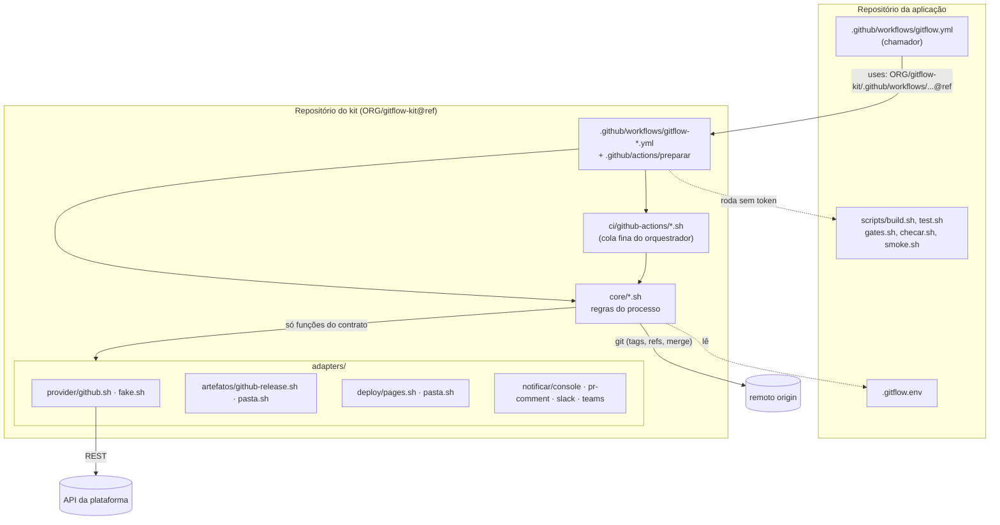
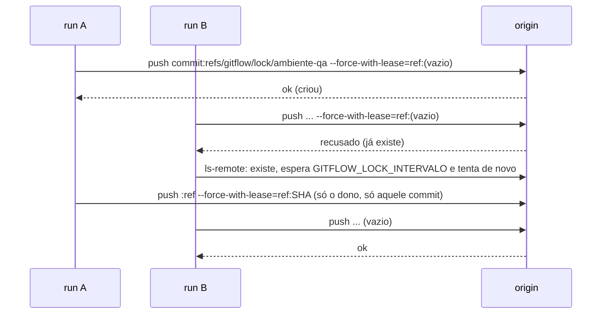

# 05 · Arquitetura e portabilidade

> Como o kit é organizado, os contratos que um adaptador precisa cumprir, o modelo de segurança e como levá-lo a
> outra plataforma Git ou outro orquestrador.

## Sumário

1. [Camadas](#1-camadas)
2. [Contratos dos adaptadores](#2-contratos-dos-adaptadores)
3. [Locks](#3-locks)
4. [Modelo de segurança](#4-modelo-de-segurança)
5. [Como portar para outra plataforma](#5-como-portar-para-outra-plataforma)
6. [Limitações conhecidas](#limitações-conhecidas)

---

## 1. Camadas

| Camada | Conteúdo | Depende da plataforma |
|---|---|---|
| `core/` | `lib.sh`, `lock.sh`, `criar-rc.sh`, `decidir.sh`, `fluxo-montar.sh`, `montar.sh`, `esteira.sh`, `pacote.sh`, `validar-tag.sh`, `regressao.sh`, `criar-release.sh`, `promover-hotfix.sh`, `publicar.sh`, `voltar.sh`, `resolver-conflito.sh` | não: só `git`, `jq`, `sh` e as funções dos adaptadores |
| `adapters/provider/` | `github.sh` (REST v3), `fake.sh` (estado em JSON, para os testes) | sim |
| `adapters/artefatos/` | `github-release.sh` (assets da Release `pacotes`), `pasta.sh` | sim / não |
| `adapters/deploy/` | `pages.sh` (GitHub Pages: `qa/`, `hom/`, raiz = PRD), `pasta.sh` | sim / não |
| `adapters/notificar/` | `console.sh`, `pr-comment.sh`, `slack.sh`, `teams.sh` (`_webhook.sh`) | — |
| `ci/github-actions/` | `falhou.sh`, `reagir.sh`, `exige-membro.sh`, `disparar-montar.sh`, chamadores-modelo | sim |
| `.github/` | 8 workflows reutilizáveis `gitflow-*.yml` + ação composta `preparar` | sim |
| `setup/`, `instalar.sh` | configuração da plataforma e cópia dos arquivos para a aplicação | sim |

`carregar_config` (em `core/lib.sh`) lê o `.gitflow.env` e carrega `adapters/provider/$GITFLOW_PROVIDER.sh`,
`adapters/notificar/$NOTIFICAR.sh`, `adapters/artefatos/$ARTEFATOS.sh` e `adapters/deploy/$DEPLOY.sh`.

---

## 2. Contratos dos adaptadores

### 2.1 Provider (`adapters/provider/<nome>.sh`)

O core usa **somente** estas funções. Retorno ≠ 0 é erro e o core trata como falha (fail-closed).

| Função | Saída / retorno |
|---|---|
| `pr_get IID` | JSON `{iid, source_branch, target_branch, draft, sha, author, description, labels[], pipeline_sha, pipeline_status, state}`; `pipeline_status` ∈ `success`, `failed`, `running`, `none`; `state` ∈ `opened`, `closed`, `merged` |
| `pr_listar_abertos` | linhas `iid branch labels_csv` dos PRs abertos para a `main`, todas as páginas, em ordem numérica |
| `pr_comentarios IID` | texto puro dos comentários do PR |
| `pr_comentar IID TEXTO` | efeito |
| `issue_comentar NUM TEXTO` | efeito (comentário numa issue) |
| `pr_rotular IID ADD REMOVE` | listas CSV; remover label ausente não é erro |
| `pr_fechar IID` | efeito |
| `branch_apagar NOME` | branch inexistente = sucesso |
| `aprovado_por_outro IID SHA AUTOR` | 0 se há aprovação de review de outra pessoa sobre `SHA` |
| `membro USUARIO GRUPO...` | 0 = membro ativo de algum grupo; 1 = não é; 2 = erro |
| `deploy_iniciar AMB REF SHA` | imprime o id do deployment (`AMB` ∈ `qa`, `hom`, `prd`; `REF` = nome da tag) |
| `deploy_concluir ID STATUS` | `STATUS` ∈ `running`, `success`, `failed` |
| `deploy_ultimo AMB` | `ref status` do deployment mais recente (vazio se não há) |
| `deploy_ultimo_ok AMB` | `ref` do deployment mais recente com status `success` |
| `deploy_ok_anterior AMB REF` | `ref` do último `success` criado antes do deployment de `REF` |
| `release_criar TAG TEXTO` | idempotente: release já existente = sucesso |
| variável `TERMO_PR` | `PR` no GitHub (padrão do core: `MR`) |

Particularidades do `github.sh`: `prd` vira o environment `production`; o "último status" de um deployment é o
primeiro que não é `inactive`; deployment sem status = `running`; o pipeline do PR combina check-runs (exceto os de
nome `gitflow*`) e statuses. Ele também expõe `gh_api`, `gh_paginar`, `gh_upload` e `gh_baixar`, usados só pelo
adaptador `github-release` e pela cola em `ci/github-actions/`.

### 2.2 Artefatos (`adapters/artefatos/<nome>.sh`)

| Função | Contrato |
|---|---|
| `artefatos_existe SHA` | 0 = `app-<sha>.zip` e `.sha256` presentes; 1 = não existe; outro = erro |
| `artefatos_publicar SHA ZIP` | nunca sobrescreve; confere o `.sha256` local; registra o hash **antes** do zip |
| `artefatos_baixar SHA DESTINO` | baixa e confere o SHA-256 registrado; `DESTINO` é diretório ou caminho do arquivo |

### 2.3 Deploy (`adapters/deploy/<nome>.sh`)

| Função | Contrato |
|---|---|
| `deploy_instalar AMB SHA VERSAO ZIP` | instala o pacote no ambiente (`VERSAO` = tag sem o `v`); grava `version.json` com `versao`, `sha`, `data` |
| `deploy_saude AMB [SHA]` | 0 se o ambiente responde e, com `SHA`, se o `version.json` tem esse `sha` |

### 2.4 Notificação (`adapters/notificar/<nome>.sh`)

| Função | Contrato |
|---|---|
| `notificar TIPO TEXTO` | `TIPO` usado pelo core: `alerta`, `publicado`. Falha de notificação nunca derruba o fluxo |

---

## 3. Locks

`core/lock.sh` implementa um lock atômico como **ref git no remoto**: `refs/gitflow/lock/<nome>` aponta para um
commit (árvore vazia) cuja mensagem é `run=<GITFLOW_RUN_ID> url=<GITFLOW_RUN_URL> desde=<UTC>`.

| Subcomando | Uso | Saída |
|---|---|---|
| `pegar NOME [ESPERA_S]` | tenta até `ESPERA_S` segundos (padrão 0) | 0 obtido; 75 ocupado (imprime o dono); 3 erro de acesso |
| `soltar NOME` | só se `run=` for o `GITFLOW_RUN_ID` atual | 0 solto ou já livre; 1 outro dono |
| `forcar-soltar NOME` | sem conferir dono (workflow `destravar`) | 0 removido ou livre; 3 erro |
| `dono NOME` | imprime a mensagem do lock (vazio = livre) | 0; 3 erro |

Por que não `concurrency` do Actions: ela cancela runs pendentes (perderia comandos) e não sobrevive entre jobs nem
existe em outras plataformas. O lock por ref funciona em qualquer remoto git. Como o `GITFLOW_RUN_ID` é o id do run (sem
o número da tentativa), **Re-run failed jobs** continua dono dos locks.

---

## 4. Modelo de segurança

| Regra | Como |
|---|---|
| Token de curta duração e escopo mínimo | `actions/create-github-app-token` por job, restrito ao repositório (`repositories:`); só nos jobs que escrevem (`preparar`, `publicar-pacote`, `implantar`, `registrar`, `falhou`, montagem, comandos, release, regressão…) |
| Código da aplicação nunca roda com o token | `construir`, `testar`, `gates`, `verificar` geram o checkout sem token do App e `permissions: contents: read` |
| Credencial do git só no ambiente | `http.extraHeader` via `GIT_CONFIG_*` em `$GITHUB_ENV`; todo checkout com `persist-credentials: false`; nada em `.git/config` |
| Token fora do argv | `curl` recebe o header de autorização por arquivo modo 600 (`gh_api`, `_gh_curl_arq`); webhooks por `curl -K` |
| Texto hostil não vira código | o comentário chega por `env:` (`NOTA`), nunca interpolado em `run:`; mensagens de tag com `-F` arquivo; testes conferem que nenhum `run:` interpola `github.event.*` ou `inputs.*` |
| Comandos rodam a versão da `main` | evento `issue_comment`; o workflow e o kit vêm da `main` e do `kit-ref` fixado, nunca do PR |
| `.gitflow.env` não confiável | leitura literal, lista de chaves permitidas; destinos que recebem credencial e segredos só pelo ambiente |
| Fail-closed | erro de API em `pr_listar_abertos`, `membro`, deployments, artefatos aborta (nunca vira "livre", "não existe" ou "sucesso"); `setup/github.sh` só trata 404 como "não existe" |
| Imutabilidade | rulesets: só o App cria tags do processo; ninguém as move ou apaga; `main`/`qa`/`hom` só pelo App |
| Decisões auditáveis | cada decisão é uma tag anotada com quem, quando, em qual build e por quê |

---

## 5. Como portar para outra plataforma

Para uma nova plataforma Git: escreva `adapters/provider/<nome>.sh` com as funções da seção 2.1, a cola do
orquestrador (equivalentes de `ci/github-actions/`) e um `setup/<nome>.sh`. O core não muda.

> [!NOTE]
> **GitLab e Jenkins estão em desenvolvimento.** As tabelas abaixo são o mapeamento planejado; nada delas está
> implementado ainda (`instalar.sh --plataforma gitlab|jenkins` responde "ainda não disponível").

### 5.1 GitLab (GitLab CI)

| Conceito do kit | GitHub (pronto) | GitLab (planejado) |
|---|---|---|
| Cartão da branch | Pull Request (`TERMO_PR=PR`) | Merge Request (`TERMO_PR=MR`) |
| Comandos no comentário | `issue_comment` → `gitflow-comandos` | webhook de Comments → API de trigger de pipeline (`TRIGGER_PAYLOAD`) |
| Grupos | Teams da organização (`membro` via `/orgs/{org}/teams/{t}/memberships/{u}`) | grupos/subgrupos (`/groups/{id}/members/all/{user}`) |
| Bot | GitHub App (token por job) | token de projeto ou grupo (`RELEASE_TOKEN`) em variável protegida |
| Branches e tags protegidas | rulesets `gitflow-*` com bypass do App | protected branches (ninguém faz push/merge exceto o bot) e protected tags |
| Checagem e aprovação de PRD | Environments com revisores (`checagem-*`, `aprovacao-prd`) | job `when: manual` em protected environment + conferência de grupo no core |
| Verdade dos ambientes | Deployments API (`qa`, `hom`, `production`) | Deployments/Environments API |
| Pipeline do PR | check-runs + statuses do último commit | pipeline do MR (`head_pipeline`) |
| Release | Releases API | Releases API |
| Pacotes | assets da Release `pacotes` | Generic Packages |
| Reações | reactions 👀 👍 👎 | award emoji |
| Montagem agendada | `schedule` do chamador | pipeline schedules com variáveis |
| Locks | `refs/gitflow/lock/*` | o mesmo (`core/lock.sh` só usa git) |

### 5.2 Jenkins (orquestrador, com GitLab ou GitHub como Git)

| Conceito do kit | Jenkins (planejado) |
|---|---|
| Workflows reutilizáveis | Jenkinsfiles num repositório separado da aplicação, chamando `core/*.sh` |
| Quem disparou (`BUILD_USER_ID`) | plugin Build User Vars |
| Checagem e aprovação de PRD | etapa `input` com `submitter` = grupo; abortar = rejeitar |
| Comandos no comentário | webhook do Git → trigger genérico do Jenkins |
| Montagem agendada | `cron` do job |
| Credenciais | Credentials Binding (token do bot), nunca em parâmetro |
| Locks | `core/lock.sh` (ou Lockable Resources, mantendo os mesmos nomes) |

---

## Limitações conhecidas

| Limitação | Efeito | Contorno |
|---|---|---|
| Rulesets não protegem `refs/gitflow/lock/*` | quem tem escrita pode apagar um lock | workflow `destravar`; acesso de escrita só a quem precisa |
| `meta/rerere` não é protegida | quem tem escrita pode publicar resoluções | revisar os commits de `meta/rerere` |
| Horários fixos no cron do chamador (UTC) | não são configuráveis pelo `.gitflow.env` | editar o `schedule` do `gitflow.yml` |
| `voltar` e `destravar` conferem `tech-leads`/`release-managers` fixos | ignoram `GRUPO_TL`/`GRUPO_RM` | usar esses slugs de Team |
| `setup/github.sh` cria Teams com slugs fixos | outros `GRUPO_*` exigem ajuste manual dos revisores | — |
| Workflows não repassam secrets além do App | `NOTIFICAR_WEBHOOK` (Slack/Teams) não chega aos jobs | usar `pr-comment`/`console` |
| `FORCAR=true` não ignora "nada mudou" | apesar da descrição do input no chamador, só desliga P6/P7 | republicar com `job=esteira` |
| `TZ` e `TERMO_PR` no `.gitflow.env` | sem efeito no GitHub | — |
| Montagem `qa`/`hom` manual e esteira manual não conferem Team | quem roda workflows pode montar/republicar | restringir quem tem `write` |
| Scripts `.ps1` da aplicação | não detectados | usar `sh` |
| Deploy em IIS, artefatos em Nexus/GitLab Packages | ainda não implementados | adaptadores `pasta`/`pages`/`github-release` |
| Locks em espera dentro de jobs | um job do Actions espera no máximo o seu timeout | montagem agendada não espera ("adiada"); manual espera até 30 min |

---

<a href="04-instalacao-github.md">⬅ 04 · Instalação</a> · <a href="../README.md">Índice</a> · <a href="06-referencia.md">06 · Referência ➜</a>

