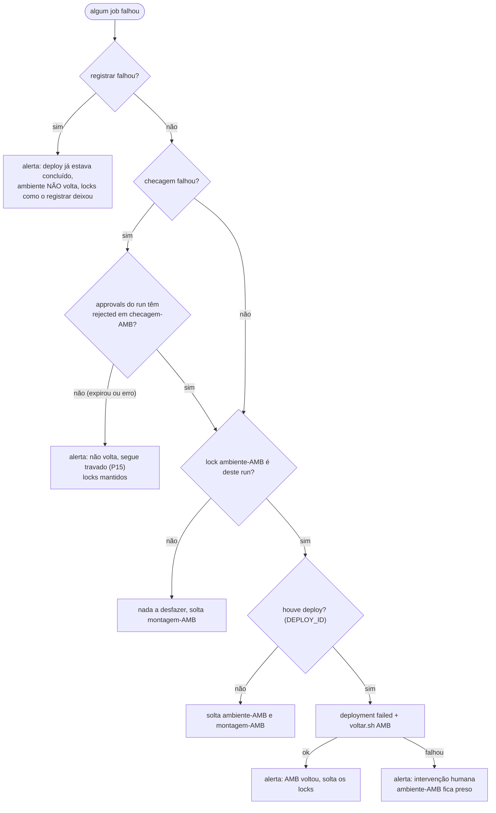

# 07 · Operação e falhas

> Runbook: para cada falha, o que o operador vê e o que faz. R0–R11 são os retornos do processo; as demais seções
> cobrem falhas da automação (montagem parada, locks presos, publicação incompleta, runs cancelados).

## Sumário

1. [Retornos R0–R11](#1-retornos-r0r11)
2. [Montagem parada](#montagem-parada)
3. [Montagem que não roda (adiada ou nada mudou)](#3-montagem-que-não-roda-adiada-ou-nada-mudou)
4. [Falhas da esteira, job a job](#4-falhas-da-esteira-job-a-job)
5. [Locks presos](#locks-presos)
6. [PRD publicado, `publicar.sh` falhou](#6-prd-publicado-publicarsh-falhou)
7. [Ambiente "aguardando checagem" para sempre](#7-ambiente-aguardando-checagem-para-sempre)
8. [Diagnóstico rápido](#8-diagnóstico-rápido)

---

## 1. Retornos R0–R11

| # | Onde falhou | O que o operador vê | O que fazer | Quem |
|---|---|---|---|---|
| R0 | Code review | `/entregar` recusado: "falta aprovação de code review (de outra pessoa, depois do último commit)" | revisor aprova o **último** commit; `/entregar` de novo | Revisor |
| R1 | CI do PR | `/entregar` recusado: "o pipeline do último commit não está verde" | corrigir na branch; esperar o `app-ci` verde | Autor |
| R2a | Montagem: conflito de entrega **em teste** | label `Montagem::Conflito`; comentário "⚠️ … conflitou na montagem … e ficou fora"; manifesto `fora: … conflito` | `git rebase origin/main`, resolver, `/entregar`; ou TL registra rerere (`resolver-conflito.sh`) | Dev + TL |
| R2b | Montagem: conflito de entrega **aprovada** | run vermelho: "PARADO: conflito em entrega aprovada: rc/… !N (aprovada)" + alerta | TL decide: rerere (fora da release), nova entrega, ou `/retirar` uma delas; depois montar de novo | TL + RM |
| R3 | QA reprovou | `qa-nok/…`, label `Ambiente::QA reprovado` | corrigir, `/entregar` (reteste expresso) | QA → Dev |
| R4 | Checagem pós-deploy | Reject em `checagem-*` → job `falhou`: "AMB voltou para a build anterior" | uma entrega nova: `/reprovar` nela; várias: TL + tester analisam ou label `Suspeita de checagem` | Tester + TL |
| R5 | HOM: Erro | `/reprovar-hom` → `hom-nok/…` | nova entrega → QA → HOM | PO + QA |
| R5a | HOM: Ajuste | `/ajuste` → `hom-ajuste/…`; continua na preview | nova entrega (sem `confirmo`, com reteste expresso) | PO + QA |
| R5b | HOM: Alteração | `/alteracao PROJ-…` → `hom-ok/…` | a mudança segue numa tarefa nova | PO |
| R6 | Regressão da release | `job=regressao RESULTADO=falhou` comenta na issue | `/reprovar-hom` na culpada; `job=montar ALVO=release VERSAO=…` de novo; nova regressão | RM + QA + TL |
| R7 | Ambiente, dado, configuração | build boa, ambiente quebrado | corrigir o ambiente; `job=esteira TAG=<build publicada> AMBIENTE=<amb>` (com `PULAR_CHECAGEM=true` se não precisa de nova checagem) | QA / DevOps |
| R8 | Smoke de PRD | job `verificar` vermelho; `falhou` volta PRD (`voltar.sh prd`); `main` não anda | `vX.Y.Z` fica queimada: hotfix a partir dela ou nova release com outro número | RM + TL |
| R9 | Incidente urgente em PRD | — | hotfix ([01 · seção 9](01-fluxo-completo.md#9-hotfix)) | TL |
| R10 | Bug não urgente em PRD | — | `bugfix/<ID>-…` a partir da `main` | PO |
| R11 | Hotfix reprovado | `qa-nok` ou `hom-nok` no PR do hotfix | novo commit em `hotfix/X.Y.Z` + `/entregar`; RM monta o hotfix de novo | QA / negócio |

---

## Montagem parada

Toda parada imprime `PARADO: …`, chama `notificar alerta`, falha o run e **solta** os locks `comandos` e
`montagem-*` (nenhuma tag foi criada).

| Mensagem | Proteção | Causa | O que fazer |
|---|---|---|---|
| "a main não é igual a PRD (vX.Y.Z). Conclua o publicar.sh antes de montar." | P5 | PRD foi publicado mas `publicar.sh` não avançou a `main` | [seção 6](#6-prd-publicado-publicarsh-falhou) |
| "conflito em entrega aprovada: …" | P4 | duas entregas aprovadas (ou aprovada vs. hotfix que moveu a `main`) conflitam | R2b |
| "entregas aprovadas fora da build sem motivo: rc/… Reabra o PR ou use /retirar." | P3 | o PR de uma entrega aprovada foi fechado (ou a branch mudou de nome), então a entrega não entrou na build | reabrir o PR; ou `/retirar <motivo>` se a branch foi abandonada |
| "ALVO=release é só para release-managers" (ou `hotfix`) | G11 | quem disparou não está em `GRUPO_RM` | pedir a um RM |
| "VERSAO inválida" / "HOTFIX inválido" | — | formato diferente de `X.Y.Z` | corrigir o input |
| "montagem-AMB ocupado após 1800s: run=…" | P11 | montagem manual esperou 30 min por outra montagem/esteira | ver o run dono; [locks presos](#locks-presos) |

---

## 3. Montagem que não roda (adiada ou nada mudou)

Estas saídas **não são erro** (run verde):

| Mensagem | Por quê | Quando volta ao normal |
|---|---|---|
| "adiada: AMB aguardando run=… url=…" | montagem agendada encontrou `montagem-AMB` preso (a esteira anterior ainda não terminou, ex.: checagem pendente) | quando a esteira anterior terminar; a próxima janela monta |
| "HOM em modo 'Release X.Y.Z': montagem adiada." | P6 | depois do PRD (remontagem automática com `FORCAR`) ou `job=montar ALVO=hom FORCAR=true` |
| "HOM em modo 'Hotfix X.Y.Z': montagem adiada." | P7 | depois do PRD do hotfix |
| "hotfix em teste: QA reservado." | P7 | depois do `promover-hotfix` (a `hom.*` Hotfix leva a entrega à HOM), ou do `/reprovar`/`/retirar` da entrega do hotfix |
| "nada mudou desde qa.…" | mesma base, rerere e entregas da build publicada | quando houver entrega/decisão nova |

---

## 4. Falhas da esteira, job a job

O job `falhou` roda quando qualquer job anterior falha (`if: failure()`), e decide por `ci/github-actions/falhou.sh`:



| Job que falhou | Locks depois | Ambiente | O que fazer |
|---|---|---|---|
| `preparar` (tag inválida, PRD sem pacote, `PULAR_CHECAGEM` em build não publicada) | `montagem-*` solto | intacto | corrigir o input; em PRD, o pacote precisa ter sido criado pela esteira da HOM |
| `construir`, `testar` | `montagem-*` solto | intacto | culpada: `/reprovar` (vale para a última build montada); montar de novo |
| `publicar-pacote` | `montagem-*` solto | intacto | ver o log (P12: "só é publicado depois de passar nos testes"; pacote já existente nunca é sobrescrito) |
| `gates` | `montagem-*` solto | intacto | corrigir na branch; `/reprovar` a culpada |
| `aprovacao` (Reject em `aprovacao-prd`) | nada preso | PRD intacto | a `vX.Y.Z` fica sem uso; nova release quando for a hora |
| `implantar` antes do deploy (lock ocupado 30 min, P9 recusou) | soltos | intacto | P9: monte a release de novo (ex.: hotfix publicado no meio) |
| `implantar` depois do deploy | soltos se a volta deu certo | voltou à build anterior | ver o log do deploy |
| `verificar` (`checar.sh`/`smoke.sh`/`deploy_saude`) | soltos se a volta deu certo | voltou | R4 / R8 |
| `checagem` Reject | soltos | voltou | R4 |
| `checagem` expirou | **presos** | build nova instalada, deployment sem status final | [seção 7](#7-ambiente-aguardando-checagem-para-sempre) |
| `registrar` | depende: se só o `publicar.sh` falhou, soltos; se `deploy_concluir` falhou, presos | build nova instalada | [seção 6](#6-prd-publicado-publicarsh-falhou) ou **Re-run failed jobs** |
| volta (`voltar.sh`) falhou | `ambiente-AMB` **preso** | indefinido | intervenção humana: corrigir e `job=voltar`, depois `job=destravar` |

> [!WARNING]
> **Run cancelado não desfaz nada e mantém os locks** (o job `falhou` só roda em falha, não em cancelamento). Depois de
> cancelar uma esteira, confira os locks e use `destravar` (seção 5).

---

## Locks presos

**Sintomas:** montagens agendadas "adiada" seguidas; montagem manual "ocupado após 1800s"; comandos de PR demorando
15 min e falhando; `implantar` esperando 30 min.

```sh
git ls-remote origin 'refs/gitflow/lock/*'                 # quais locks existem
git fetch origin 'refs/gitflow/lock/ambiente-qa:refs/x' && git log -1 --format=%s refs/x
# run=1234567 url=https://github.com/ORG/APP/actions/runs/1234567/attempts/1 desde=2026-10-14T13:05:12Z
```

| Situação do run dono | Ação |
|---|---|
| ainda rodando (ex.: esperando checagem ou aprovação) | não destrave: responda o Environment pendente |
| falhou e a volta falhou | resolva o ambiente (`job=voltar`), depois destrave |
| cancelado, ou terminou sem soltar | `job=destravar NOME=<lock>` (TL ou RM). Para uma esteira de QA/HOM, solte **os dois**: `ambiente-AMB` e `montagem-AMB` |

`destravar` aceita só `comandos`, `montagem-qa`, `montagem-hom`, `ambiente-qa`, `ambiente-hom`, `ambiente-prd`.
Locks não são protegidos por ruleset: confira quem tem escrita no repositório se um lock "sumir".

---

## 6. PRD publicado, `publicar.sh` falhou

**Sintoma:** esteira de PRD com `registrar` vermelho e "PRD publicado, mas publicar.sh falhou: rode-o de novo
(idempotente)"; alerta; a remontagem de QA/HOM não foi disparada. Toda montagem seguinte para com **P5** ("a main não
é igual a PRD").

O deployment de PRD já é `success`: **o ambiente não volta**. `publicar.sh` faz, nesta ordem e de forma idempotente:
fast-forward da `main` para `vX.Y.Z` (nunca force), label `Ambiente::PRD` + comentário + apagar a branch + fechar cada PR
publicado, aviso único nos PRs com entrega mais nova, Release do GitHub `vX.Y.Z`.

| Passo | Como |
|---|---|
| 1 | Ler o log: qual item falhou ("não foi possível mover a main", "fechar o PR !N", "criar a release") |
| 2 | Resolver a causa (permissão do App, API fora, PR já fechado à mão não é problema) |
| 3 | No run da esteira de PRD: **Re-run failed jobs**. O `registrar` roda de novo: `deploy_concluir success` (repetido, inofensivo), `publicar.sh` (até 3 tentativas), solta locks e dispara a remontagem |
| 4 | Se a remontagem não foi disparada: `job=montar ALVO=qa FORCAR=true` e `job=montar ALVO=hom FORCAR=true` |

> [!NOTE]
> Não há workflow dedicado para rodar só o `publicar.sh`. Se o run não puder ser re-executado, rode
> `sh <kit>/core/publicar.sh vX.Y.Z` num clone com as variáveis do App (`GITFLOW_PROVIDER=github`, `GITHUB_TOKEN`,
> `GITHUB_REPOSITORY`): só o App consegue avançar a `main`. `publicar.sh` exige que `vX.Y.Z` seja a versão do último
> deployment `success` de PRD.

---

## 7. Ambiente "aguardando checagem" para sempre

A checagem não tem prazo (P15). Enquanto ninguém responde: locks presos, montagens "adiada", decisões recusadas.

| Caso | O que fazer |
|---|---|
| O run ainda está esperando | o QA faz **Approve** ou **Reject** em `checagem-AMB` |
| A espera expirou (limite do GitHub) ou o run foi cancelado | os locks continuam presos e o deployment da build nova fica sem status final. A branch `qa`/`hom` **já aponta** para a build nova, então a próxima montagem pode dizer "nada mudou". Saída: `destravar` `ambiente-AMB` e `montagem-AMB`; depois, republicar com checagem: `job=esteira TAG=<a build> AMBIENTE=<amb>` (ou `job=voltar AMBIENTE=<amb>` para desistir dela) |

---

## 8. Diagnóstico rápido

| Pergunta | Comando |
|---|---|
| O que está publicado no QA? | `git fetch --tags origin qa && git tag --points-at origin/qa -l 'qa.*'` |
| O que tem nessa build? | `git tag -l --format='%(contents)' qa.2026-10-14.2` |
| Qual o estado da entrega? | `git tag -l '*/PROJ-101.*'` |
| Por que a decisão foi tomada? | `git tag -l --format='%(contents)' qa-nok/PROJ-103.1` |
| Qual a versão em PRD? | `gh api 'repos/ORG/APP/deployments?environment=production&per_page=5'` e os `statuses` de cada um |
| A `main` está igual a PRD? | compare `git rev-parse origin/main` com `git rev-parse vX.Y.Z^{commit}` |
| Quem segura um lock? | `git ls-remote origin 'refs/gitflow/lock/*'` (seção 5) |

---

<p align="center"><a href="06-referencia.md">⬅ 06 · Referência</a> · <a href="../README.md">Índice</a></p>
